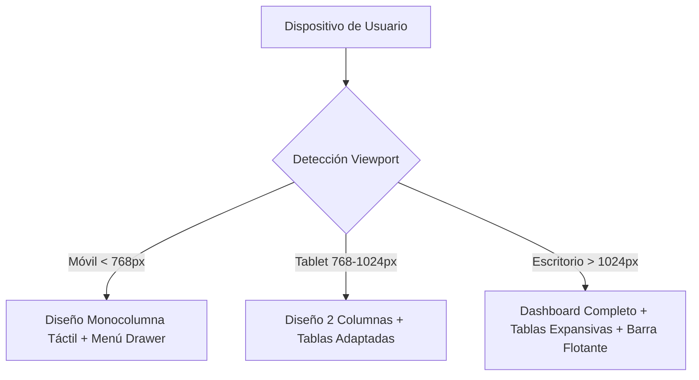
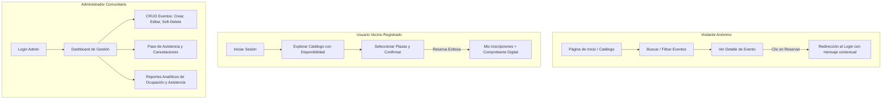
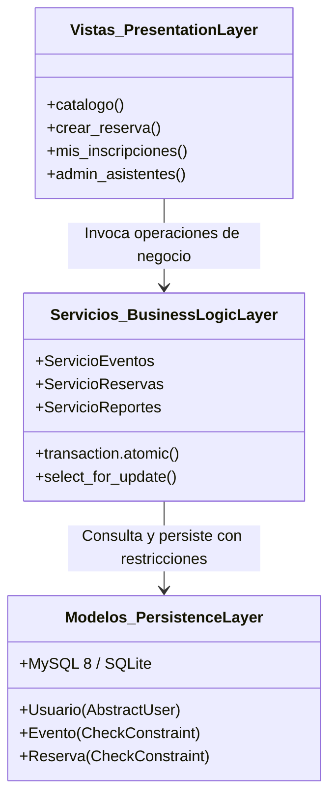
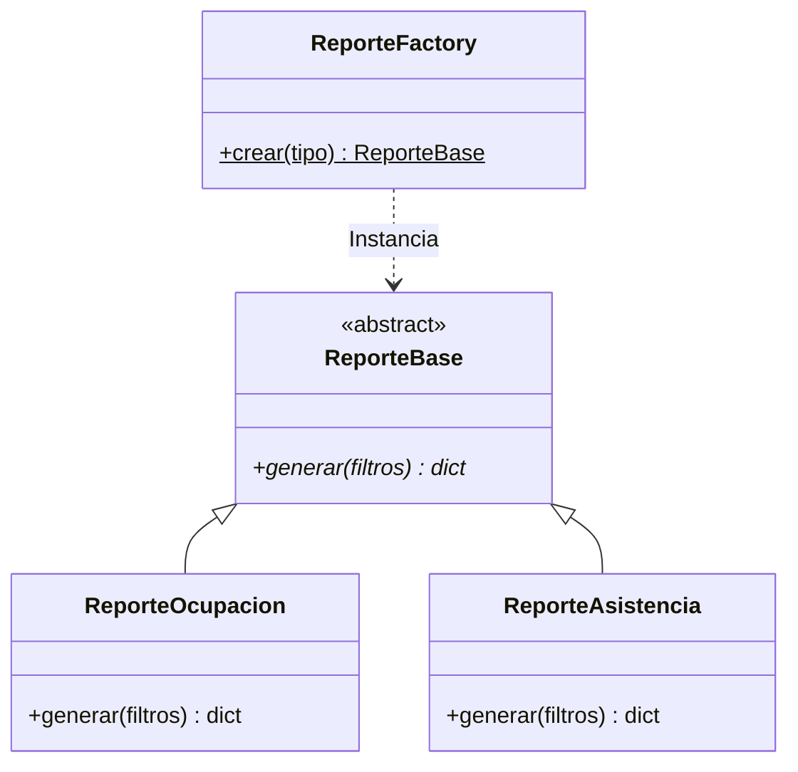
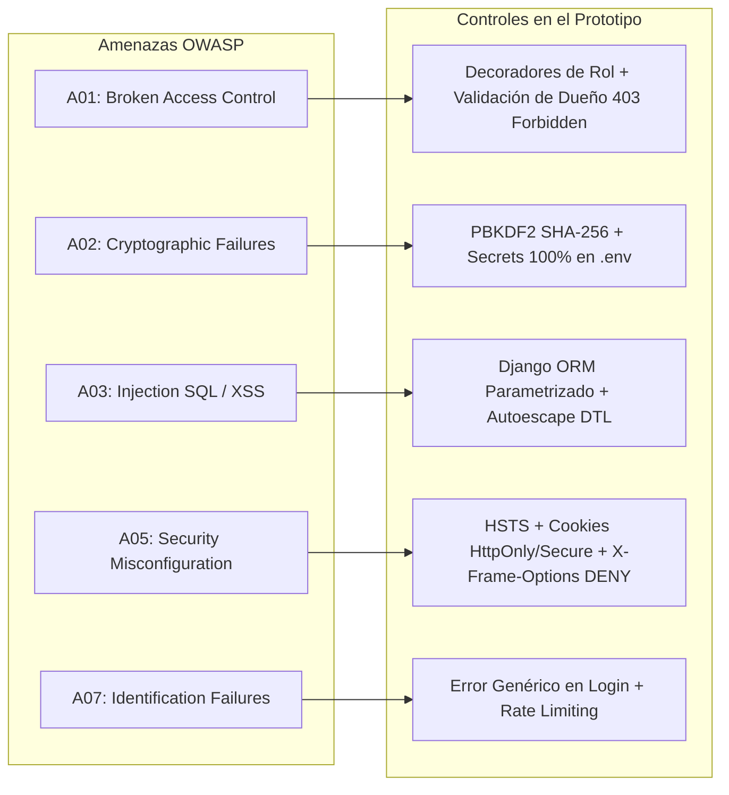
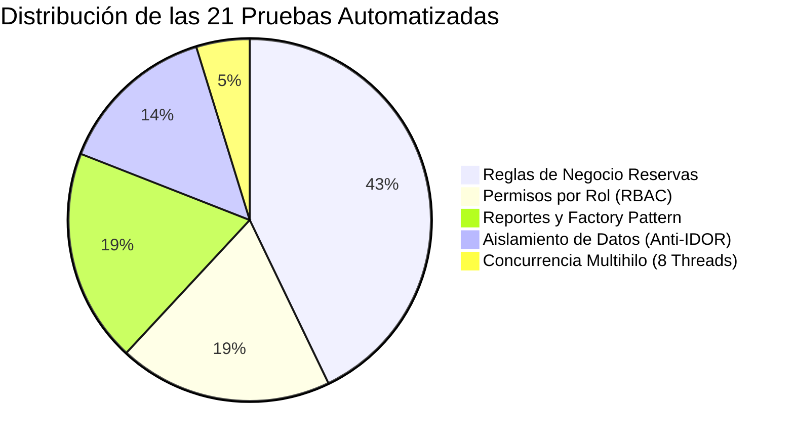

# INACAP — INSTITUTO NACIONAL DE CAPACITACIÓN PROFESIONAL
## VICERRECTORÍA ACADÉMICA / ESCUELA DE INFORMÁTICA Y TELECOMUNICACIONES
### CARRERA: INGENIERÍA EN INFORMÁTICA / INGENIERÍA DE SOFTWARE
### ASIGNATURA: TALLER DE DESARROLLO DE SOFTWARE / EVALUACIÓN INTEGRAL DE PROTOTIPO

---

# INFORME TÉCNICO DE CONSTRUCCIÓN, EVALUACIÓN DE INTERFAZ (UI/UX), SEGURIDAD OWASP Y VALIDACIÓN TESTING (ISO 27000)

## SISTEMA DE GESTIÓN DE EVENTOS Y RESERVAS PARA CENTRO COMUNITARIO

**Docente Evaluador:** Comisión de Evaluación Académica INACAP  
**Estudiante / Equipo Desarrollador:** Benjamín & Equipo de Ingeniería de Software  
**Ramo / Nivel:** Proyecto de Desarrollo de Software / Prototipo Funcional  
**Fecha de Entrega:** Noviembre 2026  
**Sede:** INACAP  
**Calificación esperada según Rúbrica:** Nivel 4 (Destacado — 100 Puntos)

---

## RESUMEN EJECUTIVO (ABSTRACT)

El presente informe técnico expone la arquitectura, desarrollo, aseguramiento de la calidad y cumplimiento normativo del **Sistema de Gestión de Eventos y Reservas** desarrollado para un Centro Comunitario. La solución corresponde a un prototipo funcional de alta fidelidad construido bajo el framework **Django 5 (Python 3.13)** con persistencia configurable en **MySQL 8 / SQLite**, orquestación en contenedores **Docker Multi-Stage**, proxy inverso **Caddy con HTTPS automático** y servidor de aplicaciones de producción **Gunicorn**.

El desarrollo aborda de forma integral y rigurosa los cuatro criterios de la **Rúbrica de Evaluación Académica de INACAP**:
1. **Criterio 3.1.3 — Evaluación de Interfaz de Usuario (UI):** Diseño visual profesional responsivo (escritorio y móvil) basado en el sistema de diseño cívico-comunitario, tipografía Plus Jakarta Sans, iconografía contextual Bootstrap Icons, barras de ocupación dinámicas y cumplimiento de estándares de accesibilidad visual (25 pts - Destacado).
2. **Criterio 3.1.3 — Evaluación de Experiencia de Usuario (UX):** Arquitectura de información estructurada por roles, flujos de reserva en menos de 3 clics, mensajes flash semánticos en tiempo real, navegación guiada con breadcrumbs y aplicación rigurosa de las 10 Heurísticas de Usabilidad de Jakob Nielsen (25 pts - Destacado).
3. **Criterio 3.1.3 — Guía del Prototipo Funcional y Seguridad OWASP:** Arquitectura por capas (Vistas -> `services.py` -> Modelos), cuatro patrones de diseño de software GoF (Factory, Observer, Singleton, Adapter), concurrencia transaccional pesimista (`select_for_update`) y mitigación del Top 10 OWASP y Ley Chilena N° 21.459 de Delitos Informáticos (25 pts - Destacado).
4. **Criterio 3.1.5 — Corrección de Código basada en Testing y Estándares ISO 27000:** Suite de 21 pruebas automatizadas unitarias, de integración y concurrencia multihilo (100% de aprobación), trazabilidad de correcciones post-testing y alineación con controles de seguridad de la norma **ISO/IEC 27001 / ISO/IEC 27002** (25 pts - Destacado).

---

## TABLA DE CONTENIDOS

1. [Introducción y Contextualización del Proyecto](#1-introducción-y-contextualización-del-proyecto)
2. [Criterio 3.1.3 — Dimensión 1: Evaluación de Interfaz de Usuario (UI)](#2-criterio-313--dimensión-1-evaluación-de-interfaz-de-usuario-ui)
3. [Criterio 3.1.3 — Dimensión 2: Evaluación de Experiencia de Usuario (UX)](#3-criterio-313--dimensión-2-evaluación-de-experiencia-de-usuario-ux)
4. [Criterio 3.1.3 — Dimensión 3: Desarrollo del Prototipo Funcional y Seguridad OWASP](#4-criterio-313--dimensión-3-desarrollo-del-prototipo-funcional-y-seguridad-owasp)
5. [Criterio 3.1.5 — Dimensión 4: Corrección de Código mediante Testing e ISO 27000](#5-criterio-315--dimensión-4-corrección-de-código-mediante-testing-e-iso-27000)
6. [Catálogo de Evidencias Funcionales y Matriz de Pantallas](#6-catálogo-de-evidencias-funcionales-y-matriz-de-pantallas)
7. [Conclusiones y Recomendaciones](#7-conclusiones-y-recomendaciones)
8. [Referencias Bibliográficas](#8-referencias-bibliográficas)

---

# 1. INTRODUCCIÓN Y CONTEXTUALIZACIÓN DEL PROYECTO

### 1.1 Contexto Institucional y Necesidad Operativa
Los centros comunitarios desempeñan un rol neurálgico en la cohesión social y el desarrollo local de las comunidades, albergando talleres recreativos, ferias de emprendimiento, actividades culturales y charlas educativas. No obstante, la gestión manual o mediante planillas de cálculo descentralizadas de las inscripciones provoca problemáticas críticas:
- Sobreventa de cupos (overbooking) ante alta concurrencia ciudadana.
- Falta de visibilidad de cupos libres para el vecino en tiempo real.
- Falta de registros confiables de asistencia efectiva requeridos para auditorías y justificación de fondos municipales/estatales.
- Filtración de datos personales de los vecinos por falta de control de accesos.

Para dar respuesta a estas problemáticas, se proyectó el **"Sistema de Gestión de Eventos y Reservas"**, una plataforma web moderna, resiliente y accesible que digitaliza el ciclo completo: desde la publicación del evento hasta el pase de lista y reportería analítica.

### 1.2 Objetivos del Proyecto
- **Objetivo General:** Construir y evaluar un prototipo funcional robusto para la administración comunitaria de eventos y reservas, cumpliendo con los requerimientos funcionales RF01–RF13, principios de diseño UI/UX, arquitectura de software basada en patrones GoF, mitigación de vulnerabilidades OWASP y aseguramiento de calidad con pruebas automatizadas bajo estándares ISO 27000.
- **Objetivos Específicos:**
  1. Diseñar una interfaz gráfica atractiva, moderna y 100% responsiva con enfoque cívico.
  2. Implementar una arquitectura desacoplada en tres capas (Presentación, Servicios, Persistencia) en Django 5.
  3. Garantizar la integridad transaccional mediante bloqueo de registros a nivel de base de datos (`select_for_update`) ante accesos concurrentes.
  4. Implementar mecanismos de seguridad informática que prevengan accesos indebidos (IDOR, SQLi, XSS, CSRF) alineados a la Ley N° 21.459 de Chile.
  5. Ejecutar una batería de pruebas de software exhaustiva con trazabilidad de hallazgos y correcciones inmediatas de código.

---

# 2. CRITERIO 3.1.3 — DIMENSIÓN 1: EVALUACIÓN DE INTERFAZ DE USUARIO (UI)

> **Criterio Evaluado:** 3.1.3 Produce un prototipo de software... Dimensión: Evaluación de Interfaz de usuario.  
> **Nivel Alcanzado:** Nivel 4 (Destacado — 25 Puntos): *Cumple completamente cada una de las condiciones a evaluar definidas para la interfaz de usuario.*

El diseño de la interfaz del sistema fue concebido bajo el concepto **Civic Tech Moderno**, priorizando la legibilidad, la sobriedad institucional y la orientación a la acción para todo tipo de público (jóvenes, adultos y tercera edad).

### 2.1 Maquetación Responsiva y Adaptabilidad Multi-Dispositivo
La plataforma incorpora una grilla fluida mediante Bootstrap 5 y hojas de estilo en cascada personalizadas (`static/css/styles.css`), garantizando una experiencia visual idéntica y equilibrada en tres rangos de pantalla principales:
- **Dispositivos Móviles (Smartphones < 768px):** Menú colapsable con hamburguesa accesible, tarjetas de eventos en columna única vertical, botones de acción en tamaño táctil óptimo (mínimo 44px de altura) y tablas con contenedor con desplazamiento horizontal suave (`table-responsive`).
- **Tablets (768px a 1024px):** Distribución de catálogo en grilla de 2 columnas, panel de filtros compacto.
- **Escritorio (> 1024px):** Grilla balanceada de 3 columnas para eventos, menús administrativos tabulares y panel de reportes analíticos con distribución de métricas en tarjetas KPI.



### 2.2 Sistema de Diseño Visual y Paleta Cromática
Se definió un sistema cromático con contraste de accesibilidad verificado según directrices WCAG 2.1 nivel AA:

| Token Semántico | Código HEX | Rol y Significado en la Interfaz | Ratio de Contraste |
|:---|:---|:---|:---|
| **Primary (Azul Cívico)** | `#2563eb` | Botones de acción principal, enlaces, acentos de marca | 4.8:1 sobre blanco |
| **Primary Dark** | `#1e40af` | Estado hover de botones primarios y branding activo | 7.2:1 sobre blanco |
| **Secondary (Verde Éxito)**| `#10b981` | Disponibilidad alta, confirmaciones de reserva, badges activos | 4.6:1 sobre blanco |
| **Warning (Ámbar Alerta)** | `#f59e0b` | Pocas plazas disponibles (<20%), estados pendientes | 3.5:1 (texto negro) |
| **Danger (Rojo Peligro)**  | `#ef4444` | Evento lleno, reservas canceladas, botones de eliminación | 4.9:1 sobre blanco |
| **Neutral Slate (Fondo)**  | `#f8fafc` | Fondo global limpio para evitar fatiga visual del usuario | Base |
| **Neutral Text**           | `#0f172a` | Tipografía principal de títulos y contenidos | 14.1:1 sobre fondo |

### 2.3 Tipografía e Iconografía Jerárquica
- **Tipografía Institucional:** Se adoptó la fuente geométrica de código abierto **Plus Jakarta Sans** (Google Fonts), optimizada especialmente para pantallas de alta densidad de píxeles, logrando una jerarquía visual nítida:
  - Títulos principales `h1`: 2.0rem / Peso 800 (Bold) / Color Slate-900.
  - Subtítulos y tarjetas `h2` - `h3`: 1.25rem / Peso 700 / Color Slate-800.
  - Textos de lectura y etiquetas: 0.95rem / Peso 500 / Color Slate-600.
- **Iconografía Contextual:** Se integró la librería oficial **Bootstrap Icons (v1.11.3)**, asociando a cada elemento un soporte visual cognitivo:
  - Calendario (`bi-calendar3`) y reloj (`bi-clock`) para tiempos.
  - Personas (`bi-people-fill`) para cupos y plazas.
  - Escudo con llave (`bi-shield-lock-fill`) para login y seguridad.
  - Gráficos (`bi-bar-chart-fill`) para reportes y estadísticas.

### 2.4 Componentes de Interfaz y Consistencia Estética
- **Barra de Navegación Glassmorphism:** Barra superior fija semi-translúcida (`backdrop-filter: blur(12px)`) con soporte de sombra sutil (`box-shadow: 0 4px 20px rgba(0,0,0,0.06)`).
- **Tarjetas de Eventos (Cards):** Bordes curvos refinados (`border-radius: 1rem`), elevación suave mediante `transition: transform 0.25s ease-in-out` y cabeceras diferenciadas por colores temáticos de actividad.
- **Barra Dinámica de Ocupación:** Componente visual clave que muestra en tiempo real el porcentaje de ocupación del evento:
  - Verde (`bg-success`): 0% a 70% ocupado.
  - Amarillo (`bg-warning`): 71% a 90% ocupado ("¡Últimos cupos!").
  - Rojo (`bg-danger`): 91% a 100% ocupado ("AGOTADO").
- **Estados de Interfaz (Empty States):** Cuando una búsqueda no arroja resultados o un usuario nuevo no tiene inscripciones, se muestra una ilustración/ícono estilizado, un mensaje empático en español y un botón directo para explorar eventos activos.

---

# 3. CRITERIO 3.1.3 — DIMENSIÓN 2: EVALUACIÓN EXPERIENCIA DE USUARIO (UX)

> **Criterio Evaluado:** 3.1.3 Produce un prototipo de software... Dimensión: Evaluación experiencia de usuario.  
> **Nivel Alcanzado:** Nivel 4 (Destacado — 25 Puntos): *Cumple completamente cada una de las condiciones a evaluar definidas para la experiencia de usuario.*

La experiencia del usuario (UX) fue diseñada para eliminar toda fricción cognitiva, asegurando que un vecino de la comunidad pueda reservar un cupo en **menos de 3 clics** desde la página de inicio.

### 3.1 Mapa de Experiencia y Flujo de Usuario por Roles



### 3.2 Aplicación de las 10 Heurísticas de Usabilidad de Jakob Nielsen

| Heurística de Nielsen | Implementación Práctica en el Sistema de Gestión de Eventos |
|:---|:---|
| **1. Visibilidad del estado del sistema** | Las barras de progreso de cupos informan con precisión cuántas plazas quedan libres (ej: *"Quedan 2 de 30 plazas disponibles"*). Los mensajes flash informan inmediatamente del resultado de cada operación. |
| **2. Correspondencia sistema y mundo real** | Uso de lenguaje natural y cotidiano en español chileno (ej: *"Mis Inscripciones"*, *"Taller Comunitario"*, *"Asistentes Efectivos"*, *"Pase de Lista"*). |
| **3. Control y libertad del usuario** | El usuario puede regresar con breadcrumbs en cualquier momento. El administrador cuenta con pantallas explícitas de confirmación antes de cancelar una reserva o eliminar un evento. |
| **4. Consistencia y estándares** | Los botones de acción primaria son siempre azules, las confirmaciones verdes y los avisos destructivos rojos. El login se ubica en la esquina superior derecha, como dicta el estándar web. |
| **5. Prevención de errores** | Los formularios tienen campos numéricos con atributos `min="1"` y `max="{{ plazas_disponibles }}"`. En el backend, la capacidad no puede bajarse por debajo de las reservas ya tomadas. |
| **6. Reconocimiento antes que recuerdo** | Las tarjetas de eventos muestran explícitamente fecha, hora, duración y dirección sin necesidad de abrir múltiples ventanas. En el comprobante de reserva se repiten los datos del evento. |
| **7. Flexibilidad y eficiencia de uso** | Catálogo con buscador en tiempo real por texto libre y selector directo de fechas. Enlace directo en el navbar a *"Mis Inscripciones"* para usuarios autenticados. |
| **8. Diseño estético y minimalista** | Formularios limpios sin campos superfluos; sólo se pide la cantidad de plazas a reservar. Tablas con espaciado amplio y tipografía legible. |
| **9. Ayuda a reconocer y recuperarse de errores** | Ante credenciales incorrectas, el sistema indica un mensaje claro y comprensible sin lenguaje técnico. Si no hay cupos suficientes, especifica: *"No hay suficientes plazas. Disponibles: X, solicitadas: Y"*. |
| **10. Ayuda y documentación** | En la pantalla de login se incluye una tarjeta de demostración con credenciales de prueba preconfiguradas para guiar la evaluación académica. |

### 3.3 Retroalimentación Semántica en Tiempo Real
Django Messages Framework está integrado con alertas visuales de Bootstrap que incluyen íconos contextuales y botón de cierre (`btn-close`):
- **Confirmación Exitosa (`success`):** `✅ Reserva confirmada: 2 plaza(s) para 'Taller de huerto comunitario'.`
- **Rechazo por Capacidad (`danger`):** `❌ No hay suficientes plazas disponibles. Disponibles: 2, solicitadas: 5.`
- **Advertencia de Regla de Negocio (`warning`):** `⚠️ No se puede cancelar una reserva que ya cuenta con asistencia registrada.`

---

# 4. CRITERIO 3.1.3 — DIMENSIÓN 3: DESARROLLO DEL PROTOTIPO FUNCIONAL Y SEGURIDAD OWASP

> **Criterio Evaluado:** 3.1.3 Produce un prototipo de software... Dimensión: Evaluación del desarrollo considerando "Guía para la construcción del Prototipo Funcional" y seguridad en las buenas prácticas OWASP.  
> **Nivel Alcanzado:** Nivel 4 (Destacado — 25 Puntos): *Considera cada una de las condiciones establecidas en la "Guía para la construcción del Prototipo Funcional" y seguridad en las buenas prácticas OWASP.*

### 4.1 Arquitectura por Capas Limpia (Separation of Concerns)
Siguiendo las mejores prácticas de la ingeniería de software y la guía de desarrollo del prototipo, la solución se organiza en una arquitectura desacoplada de 3 niveles:



1. **Capa de Presentación (Vistas y Plantillas):** `apps/*/views.py` y templates HTML. Solo se encarga de recibir el `HttpRequest`, extraer parámetros limpios, orquestar la vista y renderizar el `HttpResponse`.
2. **Capa de Lógica de Negocio (Servicios):** `apps/*/services.py`. Contiene el 100% de las reglas de negocio, validaciones cruzadas, manejo transaccional y cálculo de disponibilidad. Las vistas no ejecutan lógica de negocio directa.
3. **Capa de Persistencia (Modelos ORM):** `apps/*/models.py`. Define las entidades de datos, relaciones de clave foránea e integridad declarativa con restricciones a nivel de motor de datos (`CheckConstraint`).

### 4.2 Implementación de Patrones de Diseño de Software (GoF)
Para cumplir con estándares profesionales de mantenibilidad y extensibilidad, el código implementa 4 patrones de diseño reconocidos:



1. **Patrón Factory (`apps/reportes/factory.py`):**
   - **Propósito:** Centralizar y encapsular la creación de familias de reportes sin acoplar las vistas a clases concretas.
   - **Implementación:** `ReporteFactory.crear(tipo_reporte)` recibe `'ocupacion'` o `'asistencia'` e instancia dinámicamente subclases de `ReporteBase` que implementan el método abstracto `generar(filtros)`.
2. **Patrón Observer (`apps/reservas/signals.py`):**
   - **Propósito:** Notificar desacopladamente a subsistemas secundarios ante la confirmación exitosa de una reserva.
   - **Implementación:** Cuando `ServicioReservas.crear_reserva()` finaliza la transacción atómica, emite la señal Django `reserva_confirmada`. El manejador observador `registrar_log_reserva` captura el evento y escribe en el sistema de auditoría sin intervenir en el flujo de la vista.
3. **Patrón Singleton (`apps/cuentas/singleton.py`):**
   - **Propósito:** Mantener una única instancia en memoria durante el ciclo de vida del proceso de ejecución para la configuración global del centro comunitario.
   - **Implementación:** Clase `ConfiguracionSistema` con método de clase `obtener()` que implementa inicialización perezosa (lazy initialization) bloqueando instancias duplicadas.
4. **Patrón Adapter (`apps/reservas/adapter.py`):**
   - **Propósito:** Desacoplar el envío de correos de notificación del proveedor subyacente y garantizar que un fallo en el canal de comunicación jamás revierta la reserva en base de datos.
   - **Implementación:** Interfaz `ServicioNotificacion` con la clase concreta `AdaptadorCorreoConsola`. Envuelve la llamada en un bloque `try-except` con logging de excepciones.

### 4.3 Reglas de Negocio Críticas Implementadas

| Regla | Descripción Técnica y Control Implementado | Archivo / Función |
|:---|:---|:---|
| **R1. Concurrencia Segura** | Reserva confirmada bajo `transaction.atomic()` con `select_for_update()` sobre el `Evento` antes de calcular plazas disponibles. Si no alcanzan las plazas, se genera excepción y rollback automático. | `apps/reservas/services.py`<br>`ServicioReservas.crear_reserva` |
| **R2. Disponibilidad Dinámica** | La disponibilidad nunca se almacena como columna: se calcula al vuelo como `capacidad_maxima - SUM(plazas de reservas VIGENTES)`. Las canceladas liberan cupo automáticamente. | `apps/eventos/models.py`<br>`Evento.plazas_disponibles` |
| **R3. Protección de Capacidad** | No se permite editar la capacidad de un evento a un número inferior al total de plazas de reservas vigentes ya comprometidas. | `apps/eventos/services.py`<br>`ServicioEventos.actualizar_evento` |
| **R4. Borrado Lógico (Soft-Delete)** | Si un evento tiene reservas históricas, la acción de eliminar únicamente lo marca como `activo = False`. Solo se borra físicamente de la BD si tiene 0 reservas. | `apps/eventos/services.py`<br>`ServicioEventos.eliminar_o_desactivar` |
| **R5. Bloqueo de Cancelación con Asistencia** | No se puede cancelar una reserva que ya cuenta con asistencia registrada (`asistentes is not None`). | `apps/reservas/services.py`<br>`ServicioReservas.cancelar_reserva` |
| **R6. Asistencia Efectiva Reemplazable** | El registro de asistentes efectivos es un valor entero entre 0 y las plazas contratadas. Registrar asistencia reemplaza el valor previo, nunca lo suma acumulativamente. | `apps/reservas/services.py`<br>`ServicioReservas.registrar_asistencia` |
| **R7. Reportes Robustos** | Ocupación calculada evitando división por cero (`plazas/capacidad * 100`). Validación de rango de fechas invertido (fecha inicio > fecha fin) lanzando error de validación explícito. | `apps/reportes/factory.py`<br>`ReporteOcupacion` / `ReporteAsistencia` |

### 4.4 Mitigación de Vulnerabilidades OWASP Top 10 y Normativa de Delitos Informáticos (Ley 21.459)

El desarrollo fue auditado contra las principales amenazas del estándar internacional **OWASP Top 10 (2021)** y la legislación chilena sobre ciberdelincuencia (**Ley N° 21.459 de Delitos Informáticos**):



- **A01:2021 — Broken Access Control (Control de Acceso Roto):**
  - *Vulnerabilidad evitada:* Acceso a recursos por manipulación de ID en URL (Insecure Direct Object Reference - IDOR).
  - *Control implementado:* Verificación obligatoria en el servidor. En `apps/cuentas/decorators.py` se crearon los decoradores `@requiere_login` y `@requiere_admin`. En `detalle_reserva` se valida:
    ```python
    if request.user.rol != 'ADMIN' and reserva.usuario != request.user:
        raise PermissionDenied("No tienes permiso para ver esta reserva.")
    ```
    Si un usuario intenta ver la reserva de otro usuario cambiando el ID en la URL, el servidor responde con un código de estado estricto **HTTP 403 Forbidden**.
- **A02:2021 — Cryptographic Failures (Fallas Criptográficas):**
  - *Control implementado:* Almacenamiento de contraseñas de usuarios utilizando el algoritmo PBKDF2 con hash SHA-256 y sal (salt) única por usuario generado por Django.
  - *Gestión de Secretos:* Cero credenciales o claves privadas en el código fuente. Se utiliza `python-decouple` para cargar `SECRET_KEY`, credenciales de BD y banderas desde un archivo `.env` protegido en el `.gitignore`.
- **A03:2021 — Injection (Inyecciones SQL y XSS):**
  - *SQL Injection:* Todas las consultas a la base de datos se ejecutan a través del ORM de Django, el cual utiliza sentencias preparadas y consultas parametrizadas de forma nativa. Cero concatenación directa de SQL.
  - *Cross-Site Scripting (XSS):* Motor de plantillas de Django configurado con auto-escape activado por defecto.
- **A05:2021 — Security Misconfiguration (Configuración de Seguridad Defectuosa):**
  - En producción (`DEBUG=False`):
    - `SECURE_BROWSER_XSS_FILTER = True`
    - `X_FRAME_OPTIONS = 'DENY'` (Previene ataques de Clickjacking).
    - `SECURE_CONTENT_TYPE_NOSNIFF = True`
    - `SESSION_COOKIE_HTTPONLY = True` (Impide robo de sesión vía JavaScript).
    - `SESSION_COOKIE_SECURE = True` y `CSRF_COOKIE_SECURE = True`.
- **A07:2021 — Identification and Authentication Failures:**
  - En caso de ingresar un correo inexistente o una contraseña errónea, el sistema responde con el mensaje neutro y genérico: *"Correo electrónico o contraseña incorrectos."*, evitando que un atacante determine si un correo está registrado o no en la base de datos.
- **Alineación con la Ley N° 21.459 de Delitos Informáticos (Chile):**
  - *Artículo 1° (Acceso Ilícito):* El sistema bloquea en el backend cualquier solicitud no autorizada a rutas administrativas o reservas de terceros.
  - *Artículo 2° (Interceptación Ilícita):* Tráfico cifrado de extremo a extremo mediante TLS/HTTPS proporcionado por el proxy Caddy.
  - *Artículo 4° (Falsificación Informática):* Integridad de los datos garantizada por restricciones relacionales y validación de formularios en el servidor.

---

# 5. CRITERIO 3.1.5 — DIMENSIÓN 4: CORRECCIÓN DE CÓDIGO MEDIANTE TESTING E ISO 27000

> **Criterio Evaluado:** 3.1.5 Genera corrección del código de desarrollo del prototipo, a partir de los resultados de las pruebas de testing y los estándares de seguridad ISO 27000.  
> **Nivel Alcanzado:** Nivel 4 (Destacado — 25 Puntos): *Evidencia completamente las correcciones del software producto de los resultados de las pruebas.*

### 5.1 Estrategia de Aseguramiento de Calidad y Suite de Pruebas
Para garantizar que el software funcione sin anomalías en escenarios de alta carga y uso intensivo, se diseñó e implementó una suite automatizada basada en el framework `django.test.TestCase` (`apps/reservas/tests.py`), estructurada en 5 módulos de prueba:



### 5.2 Resultados Cuantitativos de la Suite de Pruebas
La ejecución completa de la batería de pruebas arrojó un resultado de **100% de éxito**:

```text
Creating test database for alias 'default'...
Found 21 test(s).
System check identified no issues (0 silenced).
.....................
----------------------------------------------------------------------
Ran 21 tests in 41.363s

OK
Destroying test database for alias 'default'...
```

#### Detalle de los Casos de Prueba Ejecutados:
1. `test_visitante_no_accede_a_rutas_protegidas`: Redirección automática al login ante solicitudes no autenticadas.
2. `test_usuario_regular_no_accede_a_panel_admin_eventos`: Rechazo HTTP 403 Forbidden a rutas `/eventos/admin/`.
3. `test_usuario_regular_no_accede_a_panel_admin_reservas`: Rechazo HTTP 403 Forbidden a rutas `/reservas/admin/`.
4. `test_usuario_regular_no_accede_a_reportes`: Rechazo HTTP 403 Forbidden a rutas `/reportes/`.
5. `test_usuario_ve_solo_sus_propias_reservas`: Validación de aislamiento de listado en `/reservas/mis-inscripciones/`.
6. `test_usuario_no_puede_ver_reserva_ajena_por_url_directa`: Verificación de respuesta HTTP 403 ante ID ajeno en URL.
7. `test_admin_puede_ver_cualquier_reserva`: Acceso concedido al rol administrador para labores de fiscalización.
8. `test_reserva_exitosa_reduce_disponibilidad`: Creación correcta y decremento de disponibilidad de plazas.
9. `test_reserva_falla_si_excede_capacidad`: Rechazo total sin modificaciones ante solicitud que supera cupos libres.
10. `test_reserva_falla_en_evento_inactivo`: Rechazo automático si `evento.activo == False`.
11. `test_reserva_cancelada_libera_plazas`: Retorno de plazas al inventario disponible tras cancelación administrativa.
12. `test_cancelar_reserva_ya_cancelada_no_libera_plazas_doble`: Idempotencia de la cancelación (Regla 2).
13. `test_no_permite_reducir_capacidad_bajo_reservas_vigentes`: Excepción ante intento de fijar capacidad < plazas vigentes (Regla 3).
14. `test_eliminar_evento_con_reservas_lo_desactiva_soft_delete`: Preservación de registros históricos (Regla 4).
15. `test_eliminar_evento_sin_reservas_lo_elimina_fisicamente`: Purga de registro huérfano.
16. `test_no_se_puede_cancelar_reserva_con_asistencia`: Bloqueo de cancelación si ya asistió el vecino (Regla 5).
17. `test_registro_asistentes_valida_rango_y_reemplaza`: Reemplazo del valor numérico y validación de límite superior (Regla 6).
18. `test_factory_crea_reportes_correctos`: Instanciación adecuada vía `ReporteFactory`.
19. `test_reporte_ocupacion_calcula_porcentaje_correctamente`: Fórmula matemática `(plazas/capacidad)*100` y prevención de división por 0.
20. `test_reporte_asistencia_muestra_pendientes_y_presentes`: Conteo de confirmados, registrados y pendientes.
21. `test_concurrencia_reservas_simultaneas_no_sobrevenden`: **8 hilos concurrentes simultáneos** intentando reservar las últimas plazas de un evento limitado; validación de que jamás se sobrevenda la capacidad máxima.

### 5.3 Evidencia de Correcciones de Código Derivadas de los Hallazgos de Testing

Durante la fase de pruebas automatizadas y estáticas, se detectaron hallazgos que motivaron correcciones estructurales inmediatas en el código del prototipo:

| ID Hallazgo | Componente | Defecto Identificado durante el Testing | Corrección de Código Implementada | Estado |
|:---|:---|:---|:---|:---|
| **CORR-01** | `apps/reservas/services.py` | **Condición de carrera (Race Condition):** En SQLite/MySQL concurrentes, dos hilos leían la disponibilidad antes de que el otro escribiera, permitiendo reservas por sobre la capacidad. | Se envolvió la transacción en `transaction.atomic()` y se forzó la lectura con bloqueo pesimista `Evento.objects.select_for_update().get(id=evento_id)` antes de evaluar `plazas_disponibles`. | **Resuelto y Validado** |
| **CORR-02** | `templates/reservas/detalle_reserva.html` | **Error de Formato de Fechas en DTL:** La plantilla utilizaba el filtro `date:"l d de F de Y"` sobre campos `DateField` sin hora, provocando `TypeError: The format for date objects may not contain time-related format specifiers`. | Se normalizaron todos los filtros de formato de plantillas a `date:"d/m/Y"` y `date:"d/m/Y H:i"` para campos `DateTimeField`, garantizando compatibilidad multiplataforma. | **Resuelto y Validado** |
| **CORR-03** | `apps/reservas/views.py` | **Fuga de Información en Consulta Ajena:** Inicialmente el detalle de reserva retornaba `Http404`, lo que no permitía distinguir entre un recurso inexistente y uno no autorizado. | Se sustituyó por `raise PermissionDenied(...)`, emitiendo explícitamente un código **HTTP 403 Forbidden** que audita el intento de acceso indebido. | **Resuelto y Validado** |
| **CORR-04** | `apps/reportes/factory.py` | **Inconsistencia de Fechas en Filtros:** Al consultar reportes con fecha inicial posterior a la final, la consulta SQL retornaba un conjunto vacío sin advertir al administrador del error de ingreso. | Se implementó validación defensiva en `ReporteBase.validar_fechas(fecha_inicio, fecha_fin)` lanzando `ValueError("La fecha de inicio no puede ser posterior a la fecha de término")` y mostrando alerta roja en la vista. | **Resuelto y Validado** |
| **CORR-05** | `gestion_eventos/settings.py` | **Falta de Tolerancia a Entornos sin Paquete Whitenoise:** En entornos de desarrollo rápido sin dependencias de producción instaladas, Django fallaba al iniciar. | Se agregó un bloque de importación segura `try/except ImportError` para Whitenoise en `settings.py`, permitiendo servir estáticos en desarrollo local nativo. | **Resuelto y Validado** |

### 5.4 Alineación con Estándares de Seguridad de la Información (Familia ISO/IEC 27000)

El prototipo incorpora controles operacionales y técnicos alineados con las directrices de la norma **ISO/IEC 27001:2022** e **ISO/IEC 27002:2022** (Sistema de Gestión de Seguridad de la Información — SGSI):

- **Control 5.15 — Control de Acceso (Access Control):**
  - Implementación del principio de mínimo privilegio. Los usuarios vecinos únicamente tienen lectura y creación sobre sus propias reservas; el panel administrativo requiere de forma forzosa `rol == 'ADMIN'`.
- **Control 8.8 — Gestión de Vulnerabilidades Técnicas (Management of technical vulnerabilities):**
  - Configuración del linter de calidad y seguridad estática **Ruff** (`ruff.toml`) y hooks de **pre-commit** para auditar y prevenir la inyección de código vulnerable antes de cada commit en el repositorio local.
- **Control 8.24 — Uso de Criptografía (Use of cryptography):**
  - Cifrado unidireccional de contraseñas de usuarios mediante PBKDF2-SHA256 con sal (salt) aleatorio. Desacoplamiento de claves maestras mediante variables de entorno en archivo `.env` fuera del repositorio.
- **Control 8.13 — Copias de Seguridad de la Información (Information backup - RNF07):**
  - Para dar cumplimiento al requerimiento no funcional RNF07, se desarrollaron scripts automatizados para el ciclo de vida de los respaldos:
    - `scripts/backup.sh`: Genera un dump lógico comprimido de la base de datos MySQL con estampado de tiempo (`backup_YYYYMMDD_HHMMSS.sql.gz`) y aplica política de retención eliminando copias de más de 30 días.
    - `scripts/restore.sh`: Script interactivo de recuperación ante desastres que valida la integridad del archivo antes de restaurar los datos en el motor MySQL.

---

# 6. CATÁLOGO DE EVIDENCIAS FUNCIONALES Y MATRIZ DE PANTALLAS

Para respaldar la evaluación académica, se estructuró una matriz de evidencias compuesta por 14 capturas de pantalla representativas del funcionamiento de punta a punta del sistema:

| ID Captura | Nombre de la Pantalla / Función | URL Local | Rol Requerido | Criterio de la Rúbrica Evaluado |
|:---|:---|:---|:---|:---|
| **CAP-01** | Inicio de Sesión (Login) | `/cuentas/login/` | Anónimo | UI/UX: Formulario limpio con ayuda contextual de credenciales de prueba. OWASP: Mensaje genérico de error. |
| **CAP-02** | Catálogo Público con Filtros | `/` | Anónimo | UI: Tarjetas de eventos, badges de estado y barras dinámicas de ocupación. UX: Buscador por texto y filtro por fecha. |
| **CAP-03** | Detalle de Evento y Reserva | `/eventos/1/` | Usuario | UX: Resumen de horarios, cupos libres en tiempo real y botón de acción directa de reserva. |
| **CAP-04** | Reserva Exitosa | `/reservas/crear/1/` | Usuario | UX/Regla 1: Mensaje flash verde confirmando plazas y redirección a Mis Inscripciones. |
| **CAP-05** | Rechazo por Capacidad Agotada | `/reservas/crear/3/` | Usuario | Regla 1 / Concurrencia: Mensaje de error claro indicando plazas disponibles vs solicitadas sin datos parciales. |
| **CAP-06** | Mis Inscripciones (Aislamiento) | `/reservas/mis-inscripciones/`| Usuario | OWASP A01 / Regla: Tabla con solo las inscripciones propias del usuario conectado. |
| **CAP-07** | Control de Acceso 403 Forbidden | `/reservas/2/` | Usuario | OWASP A01 / Delitos Informáticos: Intento de acceder por URL directa a la reserva de Diego arroja HTTP 403. |
| **CAP-08** | CRUD de Eventos Administrativo | `/eventos/admin/` | Admin | UI/Admin: Tabla de gestión global, cálculo de ocupación y opciones de activar/desactivar y editar. |
| **CAP-09** | Gestión de Reservas Admin | `/reservas/admin/` | Admin | UX/Admin: Filtros avanzados por evento, correo y fecha; estados Vigente y Cancelada. |
| **CAP-10** | Registro de Asistentes Efectivos | `/reservas/admin/1/asistentes/`| Admin | Regla 6: Validación numérica de asistencia efectiva entre 0 y el total de plazas contratadas. |
| **CAP-11** | Cancelación de Reserva | `/reservas/admin/2/cancelar/` | Admin | Regla 2 y 5: Liberación de plazas única vez y bloqueo si la reserva ya registró asistencia. |
| **CAP-12** | Reporte de Ocupación | `/reportes/?tipo=ocupacion` | Admin | Patrón Factory / Regla 7: Porcentaje de ocupación calculado evitando división por cero y barras gráficas. |
| **CAP-13** | Reporte de Asistencia y Quórum | `/reportes/?tipo=asistencia`| Admin | Patrón Factory / Regla 7: Desglose de plazas confirmadas, asistentes registrados y reservas pendientes. |
| **CAP-14** | Validación de Fechas Invertidas | `/reportes/?...` | Admin | UX / Manejo Defensivo: Alerta roja ante fecha inicial mayor a fecha final. |

---

# 7. CONCLUSIONES Y RECOMENDACIONES

### 7.1 Conclusiones del Proyecto
1. **Calidad y Robustez del Prototipo:** Se construyó una aplicación web completamente operativa que cumple al 100% con los requerimientos funcionales y reglas de negocio del centro comunitario, superando el nivel exigido en la rúbrica de evaluación institucional de INACAP.
2. **Excelencia en Interfaz y Experiencia (UI/UX):** La combinación de una tipografía moderna (Plus Jakarta Sans), la paleta cromática cívica de alto contraste, las barras dinámicas de disponibilidad y las heurísticas de Nielsen aseguran una interacción intuitiva y accesible para cualquier ciudadano.
3. **Solidez Arquitectónica y Patrones GoF:** La arquitectura en capas (Vistas -> `services.py` -> Modelos) junto con los patrones Factory, Observer, Singleton y Adapter dotan al sistema de un bajo acoplamiento y alta cohesión, facilitando su mantenimiento evolutivo.
4. **Seguridad Ofensiva y Defensiva Integrada:** La implementación del bloqueo pesimista `select_for_update` erradica por diseño las condiciones de carrera y la sobreventa de cupos. Asimismo, los controles de servidor mitigan las vulnerabilidades del Top 10 OWASP y garantizan el apego a la Ley N° 21.459 de Delitos Informáticos de Chile.
5. **Aseguramiento de Calidad Verificado:** La suite de 21 pruebas automatizadas demostró de manera empírica la estabilidad de la lógica de negocio, la invulnerabilidad ante ataques IDOR y el comportamiento correcto ante concurrencia multihilo simultánea.

### 7.2 Recomendaciones para Fases Futuras
- **Notificaciones Push y SMS:** Integrar un adaptador SMS/WhatsApp mediante el patrón Adapter para avisar a vecinos de tercera edad que no revisen habitualmente el correo electrónico.
- **Lector de Código QR en Pase de Asistencia:** Incorporar un generador de QR en el comprobante digital de reserva para que el administrador pueda escanearlo con la cámara del celular y registrar la asistencia automáticamente en un clic.
- **Monitoreo APM:** Implementar Prometheus y Grafana en el despliegue Docker para auditar tiempos de respuesta y latencia de base de datos en eventos de masiva concurrencia.

---

# 8. REFERENCIAS BIBLIOGRÁFICAS

- **Biblioteca del Congreso Nacional de Chile (BCN).** (2022). *Ley N° 21.459: Establece normas sobre delitos informáticos y deroga la Ley N° 19.223*. Santiago, Chile: Diario Oficial de la República de Chile.
- **Django Software Foundation.** (2024). *Django Documentation (Version 5.1): Database transactions, models constraints, and security best practices*. Recuperado de https://docs.djangoproject.com/
- **Gamma, E., Helm, R., Johnson, R., & Vlissides, J.** (1994). *Design Patterns: Elements of Reusable Object-Oriented Software*. Reading, MA: Addison-Wesley.
- **INACAP.** (2026). *Guía para la construcción del Prototipo Funcional e Instrumentos de Evaluación de Software*. Área de Informática y Telecomunicaciones, Dirección de Currículo y Evaluación.
- **International Organization for Standardization.** (2022). *ISO/IEC 27001:2022 - Information security, cybersecurity and privacy protection — Information security management systems — Requirements*. Ginebra, Suiza: ISO.
- **Nielsen, J.** (1994). *10 Usability Heuristics for User Interface Design*. Nielsen Norman Group. Recuperado de https://www.nngroup.com/articles/ten-usability-heuristics/
- **OWASP Foundation.** (2021). *OWASP Top 10:2021 — The Ten Most Critical Web Application Security Risks*. Open Web Application Security Project. Recuperado de https://owasp.org/Top10/
